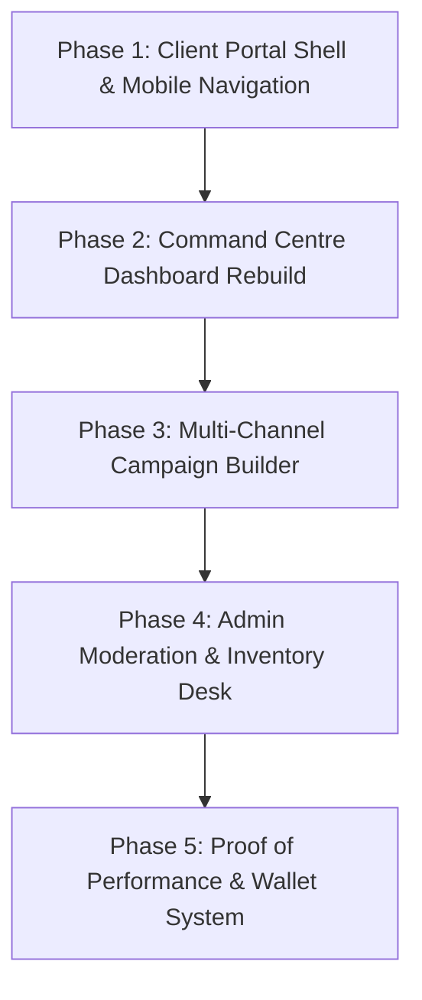

# ADVERS Platform Redesign & Architecture Strategy
**Transforming ADVERS into a Unified Multi-Channel Advertising Powerhouse**  
*Prioritizing Friction-Free Mobile UX, Streamlined Functional Modules, and High-Impact Media Placement*

---

## 1. Executive Summary: The True Purpose of ADVERS

Based on **`doc/Advers_Company_Overview_Updated-1.docx`**, the prototype code in **`doc/ADVERS_Mobile_App_Prototype.html`**, and the visual sample in **`doc/Screenshot_27-10-2026_123851_.jpeg`**, this document defines the complete architectural and UX roadmap for transforming the **Client Portal** and **Admin Backoffice**.

### What ADVERS Truly Is
> **"ONE CLICK. UNLIMITED VISIBILITY."**  
> *Advers is a marketing agency powered by its own proprietary marketing software, ADVERS.*

Unlike traditional advertising workflows bogged down by scattered vendors, fragmented price negotiation, and opaque reporting, **ADVERS bridges traditional and modern media channels into a single digital platform**. 

Advertisers (SMEs, startups, established enterprises, event promoters, and individual creators) can plan, budget, book, and monitor campaigns across **8 core media channels**:
1. **Digital Billboards (DOOH)**: Prime high-brightness LED displays along major urban corridors (Lekki, Victoria Island, Ikeja, Peter Odili PH, CBD Abuja).
2. **Static Billboards (OOH)**: High-impact unipoles, overhead gantries, and bridge panels.
3. **FM Radio Advertising**: Commercial spots, morning drive-time mentions, and sponsored segments across commercial stations.
4. **Television Advertising**: Commercials, news-hour sponsorships, and branded spots on national/regional TV.
5. **Newspaper Advertising**: Print display notices, full/half/quarter page announcements, and business press features.
6. **Podcast Advertising**: Host-read endorsements and mid-roll sponsorships on popular creator shows.
7. **AdBoosters Network**: A crowd-promoter and referral affiliate system where partners distribute brand campaigns and earn commission under published terms.
8. **Influencer Hub**: Vetted content creators and social personalities matched to targeted campaign niches.

---

## 2. Core Gap Analysis: Current Codebase vs. True Vision

| Dimension | Current Codebase Implementation | True Business Model (Overview Doc & Prototype) | Action Required |
| :--- | :--- | :--- | :--- |
| **Business Domain** | Web development agency (Domains, Sitemaps, Wireframes, CMS care plans). | **Media placement & advertising software** (Billboards, Radio, TV, Print, Podcasts, AdBoosters). | Complete domain pivot away from web dev deliverables. |
| **Client Portal (`(portal)`)** | Milestone checklist for website design ("Look Professional Tier", "Domain Provisioning"). | **Advertiser Command Centre**: Spend KPIs, 8-Channel Launchpad, Creative Asset Studio, Proof of Performance. | Rebuild `/portal/dashboard` using prototype HTML/CSS. |
| **Admin Portal (`(admin)`)** | Web agency CRM (Leads, Web Projects, Care Plan renewals, "Billboard" placeholder marked 'Soon'). | **Media Exchange Backoffice**: Campaign Moderation Queue, Inventory & Rate Cards, Station Broadcast Logs, Booster Payouts. | Rebuild `/admin` into Media Clearinghouse. |
| **Mobile Experience** | Generic responsive shrink with cluttered side menus. | **Prioritized, Native-App-Feel Touch UX**: Fixed thumb-dock, swipeable channels, bottom-sheet campaign creator. | Implement dedicated zero-clutter mobile architecture. |
| **Sidebar Navigation** | Bloated with non-functional placeholders and irrelevant agency modules. | **Strictly Streamlined & 100% Functional**: Every sidebar link has a live, operational utility. | Prune all dead weight; keep only functional modules. |

---

## 3. Prioritized Mobile-First UX Architecture (Zero-Clutter Client Experience)

The mobile experience must feel as seamless, fluid, and uncluttered as a native iOS/Android application. Clients in Nigeria manage campaigns on smartphones on the go; mobile is the primary interface.

### 3.1 Mobile UX Core Principles
1. **Zero Clutter Philosophy**: No heavy multi-column tables, no dense technical jargon, and no distracting nested sidebars on mobile screens.
2. **Thumb-Zone Ergonomics**:
   - Crucial controls (Creating a campaign, filtering channels, checking live status) are anchored within easy thumb reach.
   - Desktop sidebar is completely hidden on mobile viewports (< 768px), replaced by an ergonomic **Bottom Navigation Dock**.
3. **Fluid Touch Interactions**:
   - Channel exploration uses a responsive 2-column touch card layout or horizontal swipe gestures.
   - Status badges are high-contrast, large-tap touch targets with clear visual feedback.
   - Modals open as smooth slide-up **Bottom Sheets** (Native Mobile Modal Pattern).

### 3.2 Mobile Navigation & Layout Specifications
- **Compact Mobile Top Bar (`height: 60px`)**:
  - Left: Minimal ADVERS logo mark + bold wordmark.
  - Right: Quick Notification bell + User avatar with balance badge (tap opens user profile sheet).
  - Search trigger: Tap expands a full-screen, ultra-fast search overlay.
- **Persistent Bottom Dock Bar (`height: 68px + safe-area-inset-bottom`)**:
  - `⌂ Home` (Overview dashboard & metric cards)
  - `▣ Campaigns` (Live flights, drafts, status tracking)
  - `⊕ Create` (Centered, elevated golden accent FAB — opens the campaign creator bottom sheet)
  - `◉ Explore` (Full channel inventory and rate cards)
  - `◈ Wallet` (Quick balance check, instant top-up via Paystack)
- **Mobile Campaign Creation Flow**:
  - Full-screen drawer with a swipe-down dismissal handle (`✕` top-right).
  - Large button selectors for Channel, City, and Budget to prevent typing fatigue on small screens.
  - Native file upload sheet supporting camera photo/video upload directly from mobile storage.

---

## 4. Sidebar Pruning: Eliminating Dead Weight & Ensuring 100% Functionality

Every single navigation link must be active, functional, and directly tied to the advertising platform. Any non-functional, redundant, or web-agency legacy item must be stripped.

### 4.1 Client Sidebar Module Audit (Keep vs. Remove)

| Old / Candidate Module | Status | Decision & Rationale | Target Route |
| :--- | :--- | :--- | :--- |
| **"Projects" (Web dev)** | ❌ **REMOVE** | Irrelevant legacy web development item. Replaced by `My Campaigns`. | - |
| **"Sitemaps & Wireframes"**| ❌ **REMOVE** | Web dev artifact. Has no place in an ad platform. | - |
| **"Domain & Email Setup"** | ❌ **REMOVE** | Legacy agency hosting module. Eliminate completely. | - |
| **"Care Plans & Renewals"**| ❌ **REMOVE** | Website maintenance artifact. Eliminate completely. | - |
| **"Overview"** | ✅ **KEEP** | Primary advertiser command centre, KPIs, and quick launchpad. | `/portal/dashboard` |
| **"My Campaigns"** | ✅ **KEEP** | Real-time status of all ad flights, active airings, and PoP proofs. | `/portal/campaigns` |
| **"Explore Channels"** | ✅ **KEEP** | Interactive directory of 8 advertising media channels & rate cards. | `/portal/explore` |
| **"AdBoosters"** | ✅ **KEEP** | Promotional partner and crowd referral network. Fully functional. | `/portal/adboosters` |
| **"Influencer Hub"** | ✅ **KEEP** | Vetted content creator discovery and booking. | `/portal/influencers` |
| **"Wallet & Billing"** | ✅ **KEEP** | Escrow management, Naira wallet top-up, invoices, and receipts. | `/portal/wallet` |
| **"Support"** | ✅ **KEEP** | Direct live ticketing and 1-click WhatsApp support desk. | `/portal/support` |

### 4.2 Streamlined Client Sidebar Layout
```
[ ADVERS BRAND LOGO ]
"ONE CLICK. UNLIMITED VISIBILITY."

WORKSPACE
├── ⌂ Overview            (/portal/dashboard)
├── ▣ My Campaigns         (/portal/campaigns)
├── ◉ Explore Channels     (/portal/explore)
├── ✦ AdBoosters           (/portal/adboosters)
└── ◎ Influencer Hub       (/portal/influencers)

ACCOUNT & FINANCE
├── ◈ Wallet & Billing     (/portal/wallet)
└── ♡ Support              (/portal/support)

[ BOTTOM CALLOUT CARD ]
"Ready to grow your brand?
Turn your next big idea into a campaign people can discover."
[ ＋ Create a campaign (Button) ]
```

---

### 4.3 Admin Sidebar Module Audit (Keep vs. Remove)

| Old / Candidate Module | Status | Decision & Rationale | Target Route |
| :--- | :--- | :--- | :--- |
| **"Leads & Quotes" (Web)** | ❌ **REMOVE** | Replaced by direct Campaign Moderation Queue. | - |
| **"Web Projects"** | ❌ **REMOVE** | Irrelevant legacy web build tracker. | - |
| **"Billboard: Soon"** | ❌ **REMOVE** | No dummy placeholders! Billboards are live core inventory now. | - |
| **"Packages" (Web tiers)** | ❌ **REMOVE** | Media uses dynamic Rate Cards, not fixed website design tiers. | - |
| **"Operations Cockpit"** | ✅ **KEEP** | Overall metrics: Live flights, pending reviews, revenue, SLA alerts. | `/admin` |
| **"Campaign Moderation"** | ✅ **KEEP** | Review submitted creatives (audio/video/print), ARCON check, dispatch to media houses. | `/admin/moderation` |
| **"Media Inventory"** | ✅ **KEEP** | Manage screen networks, radio/TV stations, print papers, podcast partners, rates. | `/admin/inventory` |
| **"Proof of Performance"** | ✅ **KEEP** | Upload station broadcast logs, field inspection photos, tear-sheets for client verification. | `/admin/pop` |
| **"AdBoosters Network"** | ✅ **KEEP** | Audit crowd promoters, click fraud detection, verify conversions, batch payouts. | `/admin/adboosters` |
| **"Escrow & Settlements"** | ✅ **KEEP** | Client inflows, media house payables, promoter payouts, Advers net margins. | `/admin/finance` |
| **"Users & Advertisers"** | ✅ **KEEP** | Manage client brands, verification status, and staff access roles. | `/admin/users` |

---

## 5. Client Application Redesign: Detailed Functional Specs

### 5.1 Command Centre Dashboard (`/portal/dashboard`)
*Directly implementing the UI from the prototype image:*
1. **Dynamic Header**:
   - Day-parted greeting (`Good morning / afternoon / evening, [User] 👋`).
   - Tagline: *"Let's get your brand seen by the right people."*
   - Prominent **`＋ Create campaign`** button (launches multi-channel builder).
2. **4 Core High-Level Metric Cards**:
   - **Total Campaigns**: Total count created + monthly trend badge.
   - **Active Campaigns**: Running flights currently on-air/on-screen with pulse indicator (`● Running smoothly`).
   - **Campaign Spend**: Total deployed budget in Naira (`₦248k`).
   - **Pending Review**: Submissions currently being verified by Advers staff or media houses (`◷ Awaiting confirmation`).
3. **Hero Feature Card**:
   - Deep Obsidian card with subtle radial glow: *"Big ideas deserve to be seen."*
   - Clear value prop: *"Radio, TV, billboards, newspapers, podcasts and more. Find your next advertising opportunity in one place."*
   - Interactive gold button: *"Explore advertising opportunities →"*.
   - Orbiting ADVERS logo badge graphic on the right.
4. **8-Channel Launchpad Grid**:
   - 8 interactive touch cards with channel-specific icons:
     - **Digital Billboards**: *"Get noticed on digital screens in busy locations."*
     - **Static Billboards**: *"Build awareness with high-impact outdoor displays."*
     - **FM Radio**: *"Reach listeners across participating radio stations."*
     - **Television**: *"Bring your brand story to the TV audience."*
     - **Newspapers**: *"Promote notices, offers and brand announcements."*
     - **Podcast Ads**: *"Connect with listeners through trusted creators."*
     - **AdBoosters**: *"Extend your reach with promotional partners."*
     - **Influencer Marketplace**: *"Discover creators for your next brand campaign."*
   - Tapping any card opens the Campaign Creation Wizard with that channel pre-selected.
5. **Lower Split-Panel View**:
   - **Recent Campaigns List**: Shows real campaign entries with icons, locations, budgets in Naira, and status pills (`● Active`, `◷ In Review`, `○ Draft`).
   - **Grow with AdBoosters Panel**: Highlighting how partners can share campaigns and earn commissions, reinforcing network reach.

---

### 5.2 The Multi-Channel Campaign Builder (`/portal/campaigns/new`)
An adaptive, multi-step creation flow tailored to media channel requirements:
- **Step 1: Campaign Identity**: Name, brand category, campaign goal (Awareness, Sales/Enquiries, Event Promo, Public Notice).
- **Step 2: Media Channel & Location**: Choose from the 8 channels + target locations (Lagos, Abuja, Port Harcourt, Enugu, Kano, Nationwide).
- **Step 3: Channel Parameters**:
  - *Billboards*: Screen location, spot loop frequency (e.g. 15s in 120s rotation).
  - *Radio/TV*: Station selection, time belt (Morning drive, Afternoon, Evening peak).
  - *Newspapers*: Newspaper title, page placement (Front strip, Full page, Quarter page).
  - *Podcasts / Influencers*: Creator genre, host-read or custom content.
- **Step 4: Creative Asset Upload**:
  - Video (MP4, Full HD/4K) for digital screens and TV.
  - Audio (WAV/MP3 320kbps) or script for radio voice-over.
  - Print artwork (PDF/TIFF 300DPI) for billboards and newspapers.
- **Step 5: Budget & Escrow Lock**:
  - Transparent rate calculation with VAT (7.5%) and management fees.
  - One-click escrow funding via Naira wallet or Paystack checkout.

---

### 5.3 Proof of Performance (PoP) & Reporting (`/portal/campaigns/[id]`)
In advertising, verification builds trust. Every campaign page provides:
- **Flight Timeline & Countdown**: Real-time counter of days active and spots broadcast.
- **Visual Evidence Gallery**:
  - Geotagged, timestamped day/night photos and videos for billboard displays.
  - Downloadable official Station Certificates of Broadcast (signed transmission affidavits).
  - High-res tear-sheet scans for newspaper publications.
  - Direct streaming links and timestamps for podcast sponsorships.

---

## 6. Admin Backoffice Redesign: Operational Clearinghouse

The Admin portal (`/admin`) serves as the operational engine connecting advertisers to physical media owners and broadcast stations.

### 6.1 The 6 Core Functional Admin Modules

1. **Operations Cockpit (`/admin`)**:
   - Real-time media spend volume in Naira.
   - Live campaign flight count by channel.
   - Urgent action queue (unreviewed creatives, expiring flights, pending payouts).
2. **Campaign Moderation & Dispatch Queue (`/admin/moderation`)**:
   - Incoming campaign review queue with media asset preview (play audio, stream video, inspect print graphics).
   - ARCON compliance verification checklist.
   - 1-click **Generate Media Booking Order (PDF)** to dispatch directly to media house traffic departments.
   - Approve, Request Revision, or Reject with detailed feedback to the client.
3. **Media Inventory & Rate Cards (`/admin/inventory`)**:
   - Registry of physical screens, radio stations, TV networks, newspapers, and podcasters.
   - Availability calendar to prevent overselling screen loop capacity.
   - Dynamic rate card editor: base vendor cost vs. client selling price (automating agency markup).
4. **Proof of Performance (PoP) Dispatcher (`/admin/pop`)**:
   - Field operations upload desk for billboard photos and videos.
   - Ingestion and tagging of broadcast transmission logs.
   - Published proofs instantly sync to the corresponding client's portal.
5. **AdBoosters Network & Anti-Fraud (`/admin/adboosters`)**:
   - Audit registered crowd promoters and referral links.
   - Real-time click fraud filter (detecting bot spikes and proxy IPs).
   - Batch approval of earned promoter commissions directly to Nigerian bank accounts.
6. **Finance & Escrow Ledger (`/admin/finance`)**:
   - Complete tracking of Gross Advertiser Billings, Media Vendor Disbursements, Promoter Commissions, and Advers Net Profit Margin.

---

## 7. Immediate Implementation Plan



1. **Phase 1: Client Portal Shell & Navigation**:
   - Update `src/app/(portal)/layout.tsx` with the Obsidian `#101113` dark sidebar and the native-style bottom dock for mobile viewports.
   - Strip all legacy web agency links; wire up the 7 streamlined functional routes.
2. **Phase 2: Command Centre Dashboard Rebuild**:
   - Rebuild `src/app/(portal)/portal/dashboard/page.tsx` using the design and logic from `doc/ADVERS_Mobile_App_Prototype.html` and `doc/Screenshot_27-10-2026_123851_.jpeg`.
   - Implement the greeting, 4 metric cards, dark hero banner with orbital animation, 8-channel launchpad, and dual activity panel.
3. **Phase 3: Multi-Channel Campaign Builder**:
   - Create the responsive bottom-sheet/modal wizard with dynamic fields for Billboards, Radio, TV, Newspapers, Podcasts, and AdBoosters.
4. **Phase 4: Admin Backoffice Overhaul**:
   - Update `src/app/(admin)/layout.tsx` and `src/app/(admin)/admin/page.tsx` to remove web leads and install the Media Moderation Queue and Inventory Manager.
5. **Phase 5: Proof of Performance & Financials**:
   - Build the client-facing PoP evidence viewer and the admin-facing media dispatch and transmission log uploader.
